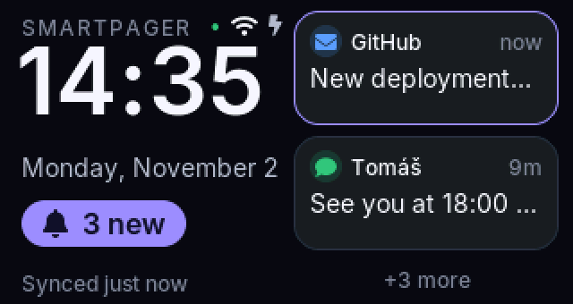
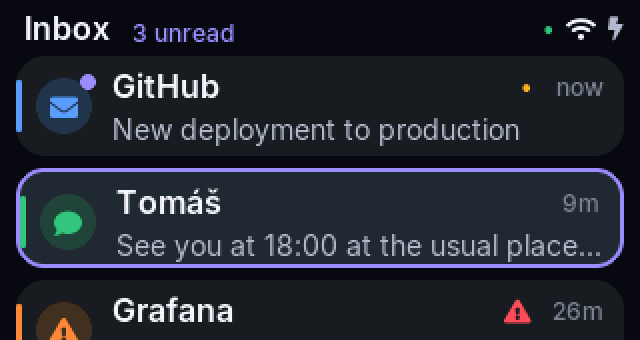
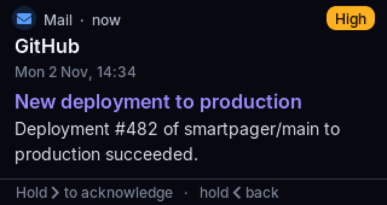
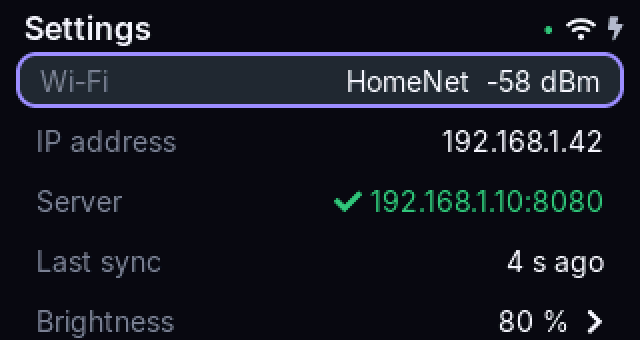

# SmartPager

A Wi-Fi pager built from a **LILYGO T-Display-S3** (ESP32-S3, 1.9" 320×170 screen) and a small self-hosted message server. Anything that can make an HTTPS request can page you: scripts, monitoring alerts, CI, an e-mail connector.

- **Fast:** a new message is on the pager in about a second, with a banner and the screen waking up.
- **Reliable:** the pager keeps its inbox through reboots and outages and catches up automatically.
- **Two-way:** opening a message marks it *read*, a long press *acknowledges* it, and both are reported back to the server.
- **Secure by default:** HTTPS with automatic Let's Encrypt certificates, a separate token for every pager and integration, the admin console off the internet, and signed firmware updates.

| Home | Inbox | Message | Settings |
|---|---|---|---|
|  |  |  |  |

*Screens rendered from the firmware's UI code at 2× size.*

## Getting started

**Follow [docs/GUIDE.md](docs/GUIDE.md).** It walks through running the server securely over HTTPS and connecting your pagers, step by step. The short version:

```bash
# on the server (Linux with Docker, ports 80/443 open, DNS pointing at it)
make env                           # .env with random secrets (git-ignored); then set SMARTPAGER_DOMAIN in it
make up-public                     # start behind HTTPS: Caddy obtains the Let's Encrypt certificate itself
make device ID=pager-1             # register a pager; prints its token once
make ingest-token NAME=my-script   # one token per script or service that sends messages

# on your own computer
make ota-keygen                    # firmware-signing key (stays here; back it up)
make fw-flash                      # flash the pager over USB, then enter Wi-Fi, https URL and token in its setup page
```

Send a message:

```bash
curl -X POST https://pager.example.com/api/v1/messages \
  -H "Authorization: Bearer spi_…" -H "Content-Type: application/json" \
  -d '{"sender":"NAS","subject":"Backup completed","priority":"normal"}'
```

Run `make` to see all commands (backups, logs, token rotation, firmware updates).

## Is it secure?

With the setup in the guide, **everything travelling over the network is encrypted with HTTPS**. Every pager checks the server's certificate, so nobody in between can read or alter messages.

Two things to know:

- **Not end-to-end.** The server and the pager store messages in readable form, so anyone with access to the server machine, its backups or the physical pager can read them.
- **The plain-HTTP home-network mode is not encrypted.** Use it only for testing.

Details are in [docs/SECURITY.md](docs/SECURITY.md#what-is-encrypted).

## Documentation

| Document | Contents |
|---|---|
| [GUIDE.md](docs/GUIDE.md) | **Start here:** secure server setup, connecting pagers, sending messages, updates, operations |
| [SECURITY.md](docs/SECURITY.md) | What is encrypted, what is exposed, credentials, limitations |
| [API.md](docs/API.md) | REST API and the device sync protocol |
| [INTEGRATIONS.md](docs/INTEGRATIONS.md) | Webhooks, Prometheus Alertmanager, e-mail (IMAP) |
| [FLASHING.md](docs/FLASHING.md) | Flashing, the hardware test image, recovery |
| [HARDWARE.md](docs/HARDWARE.md) | Board identification, pins, display and touch |
| [ARCHITECTURE.md](docs/ARCHITECTURE.md) | How the server and firmware work inside |
| [SETUP.md](docs/SETUP.md) | Development: native runs, tests, UI preview without hardware |
| [TROUBLESHOOTING.md](docs/TROUBLESHOOTING.md) | Common problems and fixes |
| [ENGINEERING_REPORT.md](docs/ENGINEERING_REPORT.md) | Build and verification log |

## Repository layout

```
server/     FastAPI + SQLite message server, admin console, webhooks, IMAP connector, tests
firmware/   PlatformIO project for the pager: LVGL UI, sync, setup portal, signed OTA, tests
deploy/     Caddyfile for the public HTTPS front end
docs/       documentation (see above)
tools/      provisioning over USB, OTA signing, font generation
scripts/    demo.sh: the full device protocol driven with curl
```

## Hardware

LILYGO T-Display-S3 (ESP32-S3R8, 16 MB flash, 8 MB PSRAM). The Touch edition with the CST816 controller is supported, and the two buttons operate everything, so touch is optional.

## License

MIT, see [LICENSE](LICENSE). Bundled fonts: Inter and Font Awesome Free (SIL Open Font License).
